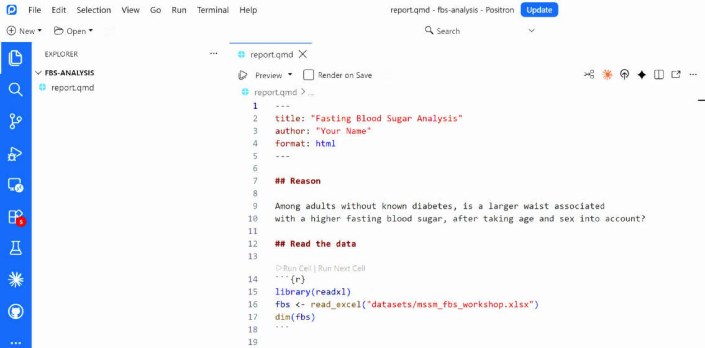
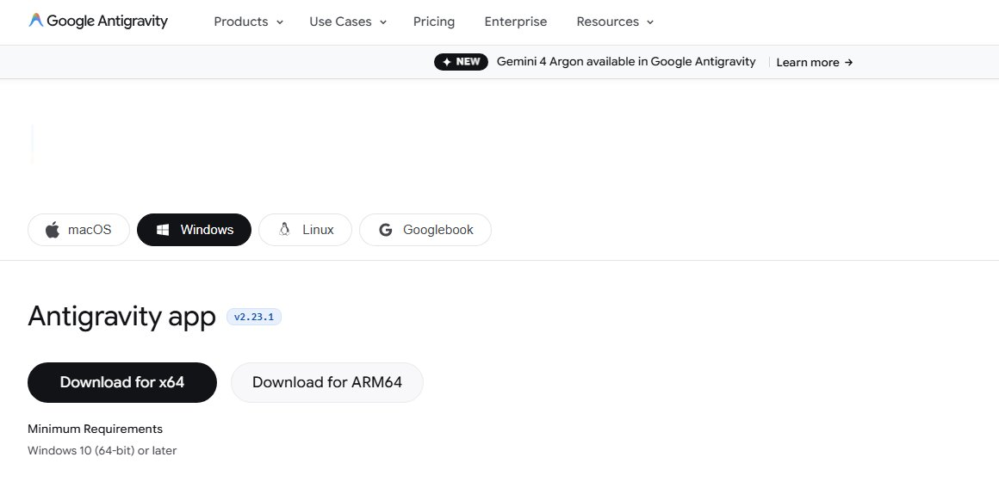

## Part 1 — Set Up Your Tools {background-color="#1A1A1A"}

Positron · Quarto · Antigravity 2.0 · Claude Desktop · GitHub

## Install Positron

::: {.goal}
Positron is a free program from Posit where you write and run R code.
:::

:::: {.columns}
::: {.column width="42%"}
- Install **R** first (4.2 or newer) from cran.r-project.org
- Then install **Positron** from positron.posit.co
- **File → Open Folder** opens your project
- **Ctrl + Enter** runs the current line
- No Positron? **Posit Cloud** runs the same code online
:::
::: {.column width="58%"}
{fig-alt="Positron with the fbs-analysis project open: files on the left, an R script in the editor, and the R console, variables and plots panes on the right." width="100%"}
:::
::::

## Quarto: Code and Words in One File

::: {.goal}
Quarto turns one file of words and code into a report, a Word document or slides.
:::

:::: {.columns}
::: {.column width="40%"}
- A `.qmd` file holds a YAML header, your text and code cells
- **Render** runs the code and builds HTML, Word, PDF or slides
- Quarto comes with Positron, so there is nothing extra to install
:::
::: {.column width="60%"}
{fig-alt="A Quarto file open in Positron, showing the YAML header at the top, a section heading and an R code cell below it." width="100%"}
:::
::::

## Quarto: The YAML Header and Structure

::: {.goal}
The YAML header at the top tells Quarto what to make.
:::

:::: {.columns}
::: {.column width="55%"}
````markdown
---
title: "Fasting Blood Sugar Analysis"
author: "Your Name"
format: html
---

## Read the data

```{{r}}
library(readxl)
fbs <- read_excel("datasets/mssm_fbs_workshop.xlsx")
```
````
:::
::: {.column width="45%"}
- Between the two `---` lines is the YAML: one `key: value` per line
- `##` starts a section; plain text is your explanation
- A code cell runs R and puts its result in the report
:::
::::

::: {.note}
Change `format: html` to `format: docx` and render again: the same file becomes a Word document.
:::

## Install Google Antigravity 2.0

::: {.goal}
Google's free agent platform. It is the AI assistant we use in today's hands-on.
:::

:::: {.columns}
::: {.column width="40%"}
- Download the **app** from antigravity.google/download
- Windows, macOS and Linux; open it and sign in when asked
- The free plan for individuals has weekly usage limits
:::
::: {.column width="60%"}
{fig-alt="The Google Antigravity download page with Windows selected, showing the Antigravity app download buttons for x64 and ARM64 and the minimum requirement of Windows 10." width="100%"}
:::
::::

## Install Claude Desktop (Optional)

::: {.goal}
Claude Desktop runs Claude Code in a window, so you do not need the terminal.
:::

- Download from claude.ai/download for Windows or macOS
- Sign in with your Claude account; Claude Code needs a paid plan (Pro, Max, Team or Enterprise)
- The app has three tabs: **Chat**, **Cowork** and **Code**
- **Code** tab → **Local** → **Select folder** opens your project
- No paid plan? Skip this slide; Antigravity 2.0 is enough for today

::: {.note}
Claude Code includes everything it needs, so there is no terminal or extra install.
:::

## GitHub Account and First Repository

::: {.goal}
GitHub keeps your code online, with a full history of every change.
:::

:::: {.columns}
::: {.column width="42%"}
- Sign up at github.com/signup with an email you will keep
- Verify your email before anything else
- Click **+** → **New repository**; name it, e.g. `fbs-analysis`
- **Private** while you work; Public when you publish
- Click **Create repository**
:::
::: {.column width="58%"}
{fig-alt="A new, empty GitHub repository page showing the repository address and the commands to push a project to it." width="100%"}
:::
::::

## Ready to Start: a Checklist

::: {.goal}
Tick all five before Part 2. Ask for help now, not during the hands-on.
:::

- Positron opens your project folder, and `1 + 1` runs in the Console
- A new `.qmd` file renders to HTML in Positron
- Antigravity 2.0 is installed and you are signed in
- Your GitHub email is verified and your first repository exists
- Optional: Claude Desktop opens your folder in the Code tab
