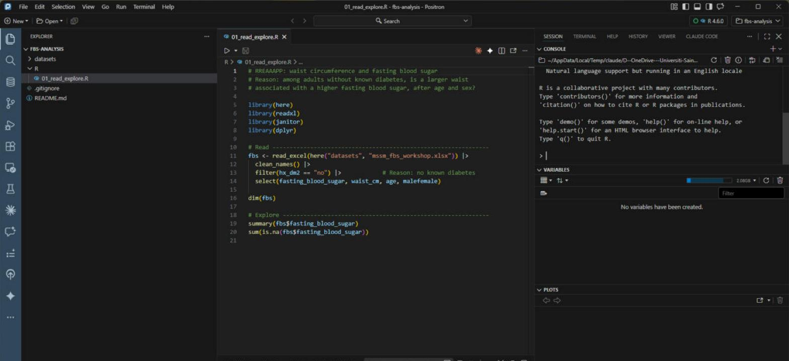
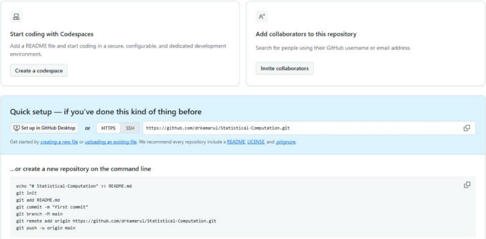

## Part 1 — The RREAAAPP Workflow {background-color="#1A1A1A"}

Reason · Read · Explore · Assume · Apply · Assess · Present · Publish

## Why You Need a Workflow

::: {.goal}
A workflow is a checklist for your thinking, not just for your code.
:::

- Without one, you open the data and "see what happens"
- Steps get forgotten or skipped when the deadline is close
- The result is something nobody can check or repeat
- With RREAAAPP you follow the same eight steps every time
- Every step is written in code, so anyone can check it and run it again

## RREAAAPP at a Glance

| | Stage | What it gives you |
|---|---|---|
| **R** | Reason | A clear question, population, outcome and variables |
| **R** | Read | The data in R, with nothing lost or changed |
| **E** | Explore | A first look: distributions, odd values, missing data |
| **A** | Assume | A written list of what the analysis depends on |
| **A** | Apply | A fitted model |
| **A** | Assess | Evidence that the model is good enough |
| **P** | Present | A table and a plain language interpretation |
| **P** | Publish | Code and report that others can check |

::: {.note}
New this year: the first R, **Reason**. Everything else follows from it.
:::

## How Each Stage Is Presented

Every stage in this part gets the same two slides.

- **Goal**: what the stage must achieve before you move on
- **Knowledge required**: what you need to understand
- **Skill required**: what you need to be able to do
- **Tools**: the R packages and programs you do it with
- Learn the shape once, then read any stage quickly

## Set Up: Install Positron

::: {.goal}
Positron is a free program from Posit where you write and run R code.
:::

:::: {.columns}
::: {.column width="42%"}
- Install **R** first (4.2 or newer) from cran.r-project.org
- Then install **Positron** from positron.posit.co
- **File → Open Folder** opens your project
- **Ctrl + Enter** runs the current line
- No Positron? **Posit Cloud** runs the same code online
:::
::: {.column width="58%"}
{fig-alt="Positron with the fbs-analysis project open: files on the left, an R script in the editor, and the R console, variables and plots panes on the right." width="100%"}
:::
::::

## Set Up: GitHub Account and First Repository

::: {.goal}
GitHub keeps your code online, with a full history of every change.
:::

:::: {.columns}
::: {.column width="42%"}
- Sign up at github.com/signup with an email you will keep
- Verify your email before anything else
- Click **+** → **New repository**; name it, e.g. `fbs-analysis`
- **Private** while you work; Public when you publish
- Click **Create repository**
:::
::: {.column width="58%"}
{fig-alt="A new, empty GitHub repository page showing the repository address and the commands to push a project to it." width="100%"}
:::
::::

## R — Reason: Know Why You Analyse

::: {.goal}
**Goal:** know exactly why you are analysing, before you open R.
:::

- **Research question**: what exactly do you want to know?
- **Study population**: who is it about, and who should be left out?
- **Outcome**: the main variable you want to explain
- **Explanatory variables**: what might be related to the outcome
- **Data**: which dataset, and does it fit this question?

::: {.note}
If you cannot write your reason in one sentence, do not open R yet.
:::

## R — Reason: Knowledge and Skill

:::: {.columns}
::: {.column width="50%"}
::: {.ks}
[Knowledge required]{.ks-label}

- Outcome versus explanatory variables
- What your study design can claim: association or cause
- What each variable means, from the data dictionary
:::
:::
::: {.column width="50%"}
::: {.ks}
[Skill required]{.ks-label}

- Write your question in one clear sentence
- Turn the Reason into decisions: which rows and columns to keep
:::
:::
::::

::: {.note}
Example: among adults without known diabetes, is a larger waist associated with
a higher fasting blood sugar, after taking age and sex into account?
:::

## R — Read Data

::: {.goal}
**Goal:** get the data into R with its types and missing values intact.
:::

- Data come from a file (CSV, Excel, SPSS, Stata) or a database; record where
- Read the data with code, never by copying and pasting
- Never edit the raw file; every change happens in your script
- The Reason decides which rows (`filter()`) and columns (`select()`) you keep
- Check the number of rows, columns and types straight after reading

## R — Read: Knowledge and Skill

:::: {.columns}
::: {.column width="50%"}
::: {.ks}
[Knowledge required]{.ks-label}

- How your file marks missing values
- Variable types: number, text, category, date
- Where the data came from and who owns them
:::
:::
::: {.column width="50%"}
::: {.ks}
[Skill required]{.ks-label}

- Import with `readxl`, `readr` or `haven`, using `here()` for paths
- Check what you read with `dim()` and `glimpse()`
:::
:::
::::

::: {.note}
Tools: readxl · readr · haven · here · janitor
:::

## E — Explore Data

::: {.goal}
**Goal:** look carefully at the data before you fit any model.
:::

- Two ways to look: graphs and summary tables
- Start with the outcome: its shape, its middle and its spread
- Impossible or unusual values show up here, or not at all
- Count the missing values and ask why they are missing
- Never delete quietly; write down every exclusion and the reason for it

## E — Explore: Knowledge and Skill

:::: {.columns}
::: {.column width="50%"}
::: {.ks}
[Knowledge required]{.ks-label}

- What a histogram, a median and a range tell you
- When a value is impossible, not just unusual
- Why missing data can bias your result
:::
:::
::: {.column width="50%"}
::: {.ks}
[Skill required]{.ks-label}

- Summarise with `gtsummary`, plot with `ggplot2`
- Record every data decision in your script
:::
:::
::::

::: {.note}
Tools: ggplot2 · gtsummary · skimr · naniar
:::

## A — Assume

::: {.goal}
**Goal:** state what your analysis depends on, before you fit it.
:::

- Every statistical method rests on assumptions
- Linear regression assumes a roughly straight line relationship
- It also assumes independent people: no repeats, no family members
- Name the roles: outcome, exposure, confounder
- Some checks come before the model; others come after it, in Assess

## A — Assume: Knowledge and Skill

:::: {.columns}
::: {.column width="50%"}
::: {.ks}
[Knowledge required]{.ks-label}

- Population versus sample
- Exposure, confounder and outcome are different roles
- Outcome types: continuous, binary, count, time to event
:::
:::
::: {.column width="50%"}
::: {.ks}
[Skill required]{.ks-label}

- Draw the relationship you assume before you fit anything
- Check for a straight line with a scatter plot and a smooth curve
:::
:::
::::

::: {.note}
Tools: ggplot2 (`geom_smooth()`) · dagitty.net · pen and paper
:::

## A — Apply Models and Methods

::: {.goal}
**Goal:** fit the model your Reason actually needs.
:::

- The outcome type chooses the model: continuous → linear, binary → logistic
- Decide first: explain a relationship (inference) or predict (prediction)
- Start simple, then add explanatory variables
- `lm()` fits a straight line through the data
- Do not interpret yet; Assess comes first

## A — Apply: Knowledge and Skill

:::: {.columns}
::: {.column width="50%"}
::: {.ks}
[Knowledge required]{.ks-label}

- Which model suits which outcome type
- Inference versus prediction
- What an estimate and its 95% confidence interval mean
:::
:::
::: {.column width="50%"}
::: {.ks}
[Skill required]{.ks-label}

- Fit with `lm()` and `glm()`, read the output with `tidy()`
- Keep every model in a script that runs from start to finish
:::
:::
::::

::: {.note}
Tools: R · Positron · lm · glm · broom
:::

## A — Assess Results and Models

::: {.goal}
**Goal:** show that the model is good enough, and say where the result applies.
:::

- Check the assumptions again, against the model you actually fitted
- Residual = observed minus predicted; good residuals form a shapeless band around 0
- Outliers and influential points are two different problems
- R² tells you how much of the variation the model explains
- If an assumption fails, say so: treat the result as approximate, or change the model

## A — Assess: Knowledge and Skill

:::: {.columns}
::: {.column width="50%"}
::: {.ks}
[Knowledge required]{.ks-label}

- What a residual plot can and cannot tell you
- The difference between an outlier and an influential point
- Internal versus external validity
:::
:::
::: {.column width="50%"}
::: {.ks}
[Skill required]{.ks-label}

- Plot residuals with `augment()` and `ggplot2`
- Decide when to revise the model and when to stop
:::
:::
::::

::: {.note}
Tools: broom · performance · car
:::

## P — Present Results

::: {.goal}
**Goal:** report the results so a reader can understand and use them.
:::

- A table, plus one plain language sentence of interpretation
- Report the estimate and its 95% CI, not the p value alone
- Say "associated with", not "causes", unless your design allows it
- Follow a reporting guideline: SAMPL for statistics, EQUATOR for study designs
- The ASA statement: a p value alone does not replace scientific reasoning

## P — Present: Knowledge and Skill

:::: {.columns}
::: {.column width="50%"}
::: {.ks}
[Knowledge required]{.ks-label}

- The SAMPL guidelines and the ASA statement on p values
- Association versus causation
- What your audience already knows and what they need
:::
:::
::: {.column width="50%"}
::: {.ks}
[Skill required]{.ks-label}

- Build tables with `tbl_summary()` and `tbl_regression()`
- Write an interpretation, not just an estimate
:::
:::
::::

::: {.note}
Tools: gtsummary · gt · Quarto
:::

## P — Publish Results, Data and Code

::: {.goal}
**Goal:** release your code and results so others can check them.
:::

- Put the code, tables and interpretation together in a Quarto report
- Keep the code on GitHub: Git records who changed what, when and why
- Share data only if ethics approval and the data owner allow it
- Never publish data that could identify anyone (even age + sex + village)
- When sharing is allowed, deposit data in Zenodo, OSF or Dryad so it can be cited

## P — Publish: Knowledge and Skill

:::: {.columns}
::: {.column width="50%"}
::: {.ks}
[Knowledge required]{.ks-label}

- What version control does that careful file naming cannot
- Ethics and consent rules for sharing health data
- Licences for code and for data
:::
:::
::: {.column width="50%"}
::: {.ks}
[Skill required]{.ks-label}

- Commit and push your project to GitHub from Positron
- Render a Quarto report from your script
:::
:::
::::

::: {.note}
Tools: Git · GitHub · Quarto · Zenodo · OSF
:::

## Reproducibility Runs Through Every Stage

::: {.goal}
Every stage should leave behind something that someone else can run again.
:::

- The raw file is read only; every change happens in code
- Relative paths with `here()`, so the project works on any computer
- Commit often, with a message that says why

```r
library(here)
library(readxl)

fbs <- read_excel(here("datasets", "mssm_fbs_workshop.xlsx"))
```

## Where Workflows Break Down

- No clear Reason, so the wrong population or outcome gets analysed
- Explore is skipped when the deadline is close, and errors surface late
- Assumptions stay in your head, so nobody can check them
- Models are fitted but never assessed
- No version control, so `final_v3_really_final.R` becomes the archive

## Part 1 — Recap

::: {.goal}
Reason · Read · Explore · Assume · Apply · Assess · Present · Publish
:::

- Reason first: one sentence before you open R
- Eight stages, in the same order, every time
- Each stage needs both knowledge and skill
- Positron to run R; GitHub to keep and share your code
- Every step in code, so others can check it and run it again
