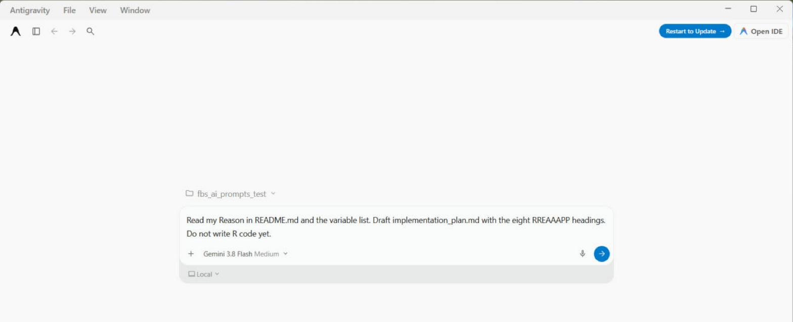

## Part 3 — AI Assistants {background-color="#1A1A1A"}

Providers · Models · Web, IDE, CLI · Antigravity 2.0 and Claude Code · Best practice

## What an AI Assistant Actually Is

::: {.goal}
A large language model, plus an interface that lets it read your problem and write you code.
:::

- It predicts text, so it writes plausible code; plausible is not the same as correct
- It cannot see your data unless you give it access
- It answers immediately, at any hour, and never tires of the same question
- It is strongest when the task is clear and the R code is common
- It is weakest when your data are unusual and your question is vague

::: {.note}
Nothing it writes becomes true because it wrote it. You still run it, and you still check it.
:::

## Three Providers That Matter

::: {.goal}
Three companies make the models most health researchers will actually use.
:::

| Provider | Model family | Where you meet it |
|---|---|---|
| **Google** | Gemini | Gemini app · Gemini API · Antigravity |
| **Anthropic** | Claude | claude.ai · Claude Code · Claude API |
| **OpenAI** | GPT | ChatGPT · OpenAI API |

::: {.note}
Model names change every few months; the three family names do not. Every model name in the next
six slides was checked against the providers' own pages on **14 October 2026**. Check again
before you quote any of them.
:::

## Google: the Gemini Family

- **Gemini 4 Argon** is Google's newest and most capable model
- **Gemini 3.8 Flash** is the newest Flash model, recommended for most new projects
- **Gemini 3.5 Flash-Lite** is the fastest, for high volume work at low cost
- **Gemini 3.1 Pro** is still available, in preview
- The **Gemini app** is the everyday assistant; **Antigravity** is the platform for building

## Anthropic: the Claude Family

- Named tiers: **Fable** for the hardest work, **Opus** the flagship, **Sonnet** fast and capable, **Haiku** the fastest
- Current models: **Fable 5.1 · Opus 5.5 · Sonnet 5.5 · Haiku 5.5**
- Anthropic suggests starting with **Opus 5.5** for most work
- Where you meet it: **claude.ai** (web, desktop, mobile) and **Claude Code**
- Anthropic's cookbook shows a data analyst agent: a CSV goes in, an HTML report comes out

## OpenAI: the GPT Family

- **GPT-6** is the current generation, with members named rather than numbered
- **GPT-6 Astra** is the flagship, for complex reasoning and coding
- **GPT-6.1 Sol** balances capability against cost
- **GPT-6 Luna** is the cheapest, for high volume work
- **ChatGPT** is the assistant; the same models are sold through the API

## What "Frontier Model" Means

::: {.goal}
Frontier means the most capable model a company has: kept closed, and rented as a service.
:::

- The model stays with the company; you rent access through an app or an API
- You pay per token, roughly per word you send and per word you get back
- New abilities appear in frontier models first
- Every prompt leaves your computer, which is why the confidentiality slide matters
- Models change every few months, so write down which model produced your results

## Frontier Models Today

| Provider | Newest | Models in the line-up |
|---|---|---|
| **Google** | Gemini 4 | 4 Argon · 3.8 Flash · 3.5 Flash-Lite · 3.1 Pro *(preview)* |
| **Anthropic** | Claude 5 | Fable 5.1 · Opus 5.5 · Sonnet 5.5 · Haiku 5.5 |
| **OpenAI** | GPT-6 | Astra · 6.1 Sol · Luna |

::: {.note}
As listed on the providers' own pages on 14 October 2026. Expect this table to be out of date
within a semester.
:::

## Open-Weight Models

::: {.goal}
Open weights mean you can download the model and run it on a computer you control.
:::

- **Gemma 4** (Google) and **gpt-oss** (OpenAI): Apache 2.0 licence, small versions run on one good computer
- **Qwen** (Alibaba) and **DeepSeek V4** (MIT licence) are near the top of many open rankings
- **Llama 4** (Meta) uses Meta's own community licence
- New leaders appear every few months; always read the licence before you use one
- Tools such as **Ollama** make a laptop or a department server enough to start

## Frontier vs Open: the Trade-Off

| | Frontier | Open-weight |
|---|---|---|
| **Cost** | Pay per token; no hardware to buy | Model is free; your hardware and time are not |
| **Privacy** | Data leave your computer | Data can stay on your computer |
| **Control** | The model can change under you | Keep one version for as long as you need |
| **Capability** | Highest available | Close behind, and the gap keeps narrowing |

::: {.note}
For identifiable patient data, the privacy row often settles the question on its own.
:::

## Health Data: the Confidentiality Question

::: {.goal}
Pasting patient data into a chat box sends them to a company's servers, often in another country.
:::

- Consumer plans may use your chats for training, depending on a setting; find that setting
- Business and API plans usually have stricter terms; read your vendor's terms
- Malaysia's PDPA, amended in 2024, governs sending personal data abroad
- Your ethics approval may forbid it even when the law allows it
- Safe default: de-identify, or share only column names, types and a made-up sample

## Three Places to Use an Assistant

::: {.goal}
The same model behaves like three different tools, depending on where you use it.
:::

- **Web**: a browser tab; you paste in and copy out
- **IDE**: inside the program where you write code; it can read your open project
- **CLI**: in the terminal; it can read, write and run files in your project folder
- The further down this list, the more the assistant can do without you
- The further down this list, the more carefully you must supervise it

## Web: How It Works

::: {.goal}
You bring the problem to a browser tab; the assistant never sees your project.
:::

- Describe the problem, paste a small data sample, read the answer
- Copy the code into Positron and run it there
- Improve it by conversation instead of starting again
- Examples: the **Gemini app**, **claude.ai**, **ChatGPT**
- Nothing to install, so this is where everyone should start

## Web: Pros and Cons

:::: {.columns}
::: {.column width="50%"}
::: {.ks}
[Strengths]{.ks-label}

- No setup at all
- Easy to compare assistants side by side
- Good for learning and one-off questions
:::
:::
::: {.column width="50%"}
::: {.ks}
[Limits]{.ks-label}

- Copy and paste in both directions
- It cannot see your files, so you supply all the context
:::
:::
::::

## IDE: How It Works

::: {.goal}
The assistant lives inside your code editor and can see the project you have open.
:::

- It reads the files in your project, so you stop pasting context by hand
- It suggests edits in place, which you accept or reject one by one
- Example: **Posit Assistant** in Positron, which also sees your loaded data and plots
- Examples: the **Antigravity IDE**, and **Claude Code** in VS Code or JetBrains
- You still run the code, and you still read every change before you accept it

## IDE: Pros and Cons

:::: {.columns}
::: {.column width="50%"}
::: {.ks}
[Strengths]{.ks-label}

- It sees your files, data and plots
- Changes arrive as edits you can review
- One window for writing, running and asking
:::
:::
::: {.column width="50%"}
::: {.ks}
[Limits]{.ks-label}

- Needs installing, setting up, and an account or API key
- Easy to accept a change you did not read
:::
:::
::::

## CLI: How It Works

::: {.goal}
The assistant runs in your terminal, inside your project folder, and can act on files.
:::

- You start it in the folder; the folder is what it works on
- It can read files, write files, run scripts and read the errors
- Examples: **Claude Code** (type `claude`) and the **Antigravity CLI**
- It suits work that spans many files and many steps: a whole analysis
- It asks permission before acting; read each request, do not click straight through

## CLI: Pros and Cons

:::: {.columns}
::: {.column width="50%"}
::: {.ks}
[Strengths]{.ks-label}

- Handles work that spans many files
- Runs the code and reads its own errors
- Works naturally with Git and GitHub
:::
:::
::: {.column width="50%"}
::: {.ks}
[Limits]{.ks-label}

- The most independence, so it needs the most supervision
- A vague instruction can lead to many wrong changes
:::
:::
::::

## Google Antigravity 2.0

::: {.goal}
Google's agent platform: one place to run several AI agents on your projects.
:::

:::: {.columns}
::: {.column width="40%"}
- Four ways in: a desktop **app**, an **IDE**, a **CLI** and a Python **SDK**
- The app is a command centre for running several agents side by side
- Runs Gemini models, including Gemini 4 Argon; free for individuals
:::
::: {.column width="60%"}
{fig-alt="The Google Antigravity 2.0 app with a project selected, Gemini 3.8 Flash chosen as the model, and a RREAAAPP planning prompt typed into the box." width="100%"}
:::
::::

## Claude Code

::: {.goal}
Anthropic's coding agent: it reads your project, edits files and runs commands.
:::

- Runs in the terminal, in VS Code and JetBrains, in a desktop app, and on the web
- Reads a `CLAUDE.md` (or `AGENTS.md`) file of project rules every time it starts
- Needs a paid Claude plan or an Anthropic API account
- Easiest start: the **Code** tab in Claude Desktop, installed in Part 1

## Web, IDE, CLI Compared

| | Web | IDE | CLI |
|---|---|---|---|
| **Setup** | None | Install an editor | Install and sign in |
| **Sees your files** | No, you paste | Yes, the open project | Yes, the whole folder |
| **Runs your code** | No | You run it | Yes, with permission |
| **Best for** | Learning, one-off questions | Everyday analysis | Many files, many steps |

::: {.note}
Start on the web. Move to the IDE when copy and paste gets tiring. Move to the CLI when the task
spans many files.
:::

## Best Practice: Plan Before You Prompt

::: {.goal}
Write the plan first; the plan is the prompt.
:::

- Say what the data are, what the outcome is, and which model you intend to fit
- Give it the data dictionary: variable names, types, units, missing value codes
- Give it R code that already works in your group, so its answer matches your style

```r
# A RREAAAPP plan you can hand over, stage by stage
# 1. Reason   adults without diabetes; FBS ~ waist + age + sex
# 2. Read     datasets/mssm_fbs_workshop.xlsx; keep hx_dm2 == "no"
# 3. Explore  histogram of FBS; count values below 3 and missing
# 4. Assume   straight line (scatter + loess); independent people
# 5. Apply    lm(fasting_blood_sugar ~ waist_cm + age + malefemale)
# 6. Assess   residuals vs fitted; R-squared
# 7. Present  tbl_regression(); one sentence of interpretation
# 8. Publish  Quarto report and code to GitHub; no data
```

## Best Practice: Verify Everything

::: {.goal}
Code that runs is not the same as code that is right.
:::

- Run it, then check the numbers against a result you already trust
- Check the number of rows at every step; quietly losing people is the most common error
- Read every line before you publish it; if you cannot explain it, do not use it

```r
nrow(fbs_raw)
nrow(fbs)                                 # did a filter drop people?
table(fbs$malefemale, useNA = "ifany")    # did a recode invent a category?
```

## Best Practice: Protect the Data

::: {.goal}
De-identify before you share, and know where the data actually go.
:::

- Remove names, IC numbers, addresses, dates and free text before sharing anything
- Share structure, not content: column names, types, ranges and a made-up sample
- Know your plan: consumer chat and paid API have different data rules
- Check your institution's policy and your ethics approval first
- If in doubt, run an open-weight model on your own computer instead

## Best Practice: You Remain the Analyst

::: {.goal}
The assistant speeds up the analysis. It does not own it; your name is on the paper.
:::

- Vague prompts get vague code: name the variables, the model and the output you want
- Give it resources: the data dictionary, your Reason, working example code
- Planning too little costs far more time than planning would have taken
- Not checking the output means publishing its mistakes under your name
- Do not let the AI become the master; the judgement stays with you

::: {.takeaway}
RREAAAPP gives the structure, the assistant gives the speed, your expertise gives the quality.
:::
